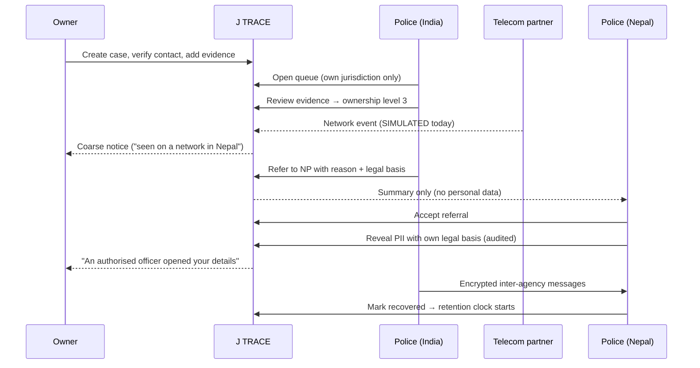
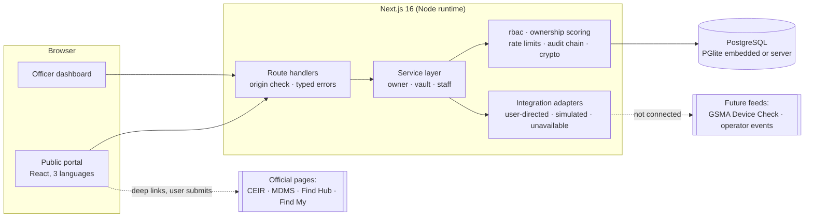
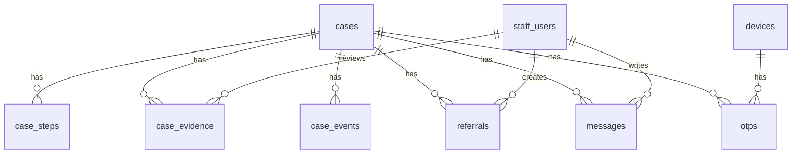

# Phase 4 — Product blueprint

## 1. Two interfaces, one case

| | Public recovery portal | Authorised recovery dashboard |
|---|---|---|
| Who | Anyone who has lost a phone | Verified police, telecom nodal officers, platform admin, independent auditor |
| Routes | `/`, `/start`, `/case`, `/protect`, `/feasibility` | `/dashboard`, `/dashboard/case/:id`, `/dashboard/audit` |
| Languages | English, Hindi, Nepali | English |
| Sign-in | None. A case is opened with a reference + secret key; the browser holds an HttpOnly session for that one case | E-mail + password; accounts created by an admin after the agency is confirmed. No self-registration |
| Sees | Own checklist, own masked identifiers, coarse status notices | Cases in own jurisdiction; personal data only after recording a legal basis |

## 2. User journeys

### Owner — the first 15 minutes

```mermaid
flowchart TD
  A[Phone is gone] --> B[Open J TRACE on any device]
  B --> C[3-step form: what happened · the phone · you + consent]
  C --> D[Case reference + secret key shown once]
  D --> E[Checklist in own language]
  E --> E1[Locate / ring — Google, Apple, Samsung page]
  E --> E2[Lock + call-back message]
  E --> E3[Block SIM — operator helpline]
  E --> E4[Protect bank / UPI / accounts]
  E --> F{IMEI known?}
  F -- no --> F1[Vault recovery · Google/Apple account · box · invoice]
  F1 --> G
  F -- yes --> G[Police complaint — draft generated]
  G --> H[IMEI block — hand-off to CEIR / MDMS / operator]
  H --> I[Record request number]
  I --> J[Verify ownership: contact code, vault match, documents]
  J --> K[Status notices · mark recovered · auto-deletion]
```

### Officer — a cross-border case

## 3. System architecture

Design choices worth noting

- **One deployable.** Front end, API and adapters ship as one Next.js app, so a pilot needs one host and one database.
- **PostgreSQL everywhere.** Tests and the zero-setup demo run on PGlite (PostgreSQL compiled to WASM); production sets `DATABASE_URL`. The schema and SQL are identical.
- **Service layer is framework-free.** Every rule (jurisdiction, scoring, disclosure) lives in `src/lib/services/*` and is exercised directly by tests; route handlers are thin.
- **Adapters declare their own honesty.** Each integration is `user_directed`, `simulated` or `unavailable`; a test fails if a privileged integration claims to be live.
- **Events, not polling.** Everything that happens to a case is a row in `case_events` with a visibility and a minimum ownership level. A real feed would insert the same rows; notification delivery hangs off them.

## 4. Technology stack

| Layer | Choice | Why |
|---|---|---|
| UI | Next.js 16 (App Router), React 19, hand-written CSS | No client framework lock-in, small bundle for low-end phones, system fonts that include Devanagari |
| API | Next.js route handlers on the Node runtime | Same deploy unit; standard `Request`/`Response`, testable without a server |
| Data | PostgreSQL (node-postgres) / PGlite | Relational integrity, advisory locks for the audit chain, runs embedded for tests |
| Sessions | HS256 JWT (jose) in HttpOnly, SameSite=Strict cookies | No token in JavaScript; separate signing keys for owner and staff |
| Crypto | `node:crypto` — AES-256-GCM, HKDF-SHA-256, HMAC-SHA-256, scrypt | No third-party crypto code |
| Tests | Vitest | Fast, each file gets its own in-memory database |
| Hosting | Vercel (demo) · any Node host + managed Postgres in-region (pilot) | Data-residency expectations in IN/NP/AE favour in-country hosting for a real pilot |

Not yet wired (deliberately, see roadmap): SMS/e-mail gateway, Redis-backed rate limiting, staff MFA, object storage.

## 5. Database schema

Defined in [`src/lib/schema.ts`](../src/lib/schema.ts). Naming: `*_enc` = AES-256-GCM ciphertext, `*_hmac` = keyed pseudonym for lookups.

| Table | Purpose | Sensitive columns |
|---|---|---|
| `cases` | One recovery case | `contact_enc`, `phone_enc`, `imei_enc`, `owner_name_enc`, `incident_place_enc`; lookups via `*_hmac`; `access_key_hash` |
| `case_steps` | Checklist progress | — |
| `case_evidence` | Ownership evidence (kind, status, SHA-256 fingerprint, reviewer) | Fingerprints only; no files are stored |
| `case_events` | Timeline: source, `simulated`, `visibility`, `min_level` | Payloads carry no identity |
| `devices` | Pre-loss vault | `imei_enc`, `recovery_contact_enc`; `imei_hmac` unique |
| `otps` | One-time codes | `code_hash` only, attempt counter, expiry |
| `referrals` | Cross-border referrals with reason and legal basis | — |
| `messages` | Inter-agency notes | `body_enc` |
| `staff_users` | Officers | scrypt `password_hash`, `verified`, `disabled`, `jurisdiction` |
| `outbox` | Notification queue (simulated delivery) | `to_enc` |
| `audit_log` | Append-only hash chain | No raw identifiers; survives case deletion |

## 6. API specification

All endpoints are JSON, same-origin, `Cache-Control: no-store`. Errors are `{ "error": "<code>", ... }` with a 4xx/5xx status; `429` carries `Retry-After`. State-changing requests with a foreign `Origin` are rejected (`403 bad_origin`).

### Public / owner

| Method & path | Body | Result |
|---|---|---|
| `POST /api/cases` | `country` (IN/NP/AE), `incidentType` (lost/stolen), `contact`, `consent: true`, optional `incidentAt`, `incidentPlace`, `platform`, `brand`, `model`, `phone`, `imei`, `ownerName`, `locale` | `201 { ref, accessKey }` + owner session cookie |
| `POST /api/cases/open` | `ref`, `accessKey` | `200 { ref }` + cookie · `404 case_not_found` (identical for wrong key and unknown reference) |
| `GET /api/case?locale=` | — | Owner view: status, masked identifiers, checklist, evidence, visible events, verification summary, hand-off details |
| `DELETE /api/case` | — | Erases the case · `409 erasure_restricted` while disputed/referred |
| `POST /api/case/actions` | `{ action: "otp_request" }` | `{ sent, to, simulatedDelivery, demoCode? }` |
| | `{ action: "otp_confirm", code }` | `{ verified, level, score }` |
| | `{ action: "evidence", kind, sha256?, reference?, fileName? }` | `{ level, score }` |
| | `{ action: "step", key, done, requestId? }` | `{ ok }` |
| | `{ action: "imei", imei }` | `{ disputed }` · `409 imei_locked` |
| | `{ action: "complaint", locale }` | `{ locale, text }` |
| | `{ action: "recovered" }` / `{ action: "signout" }` | `{ ok }` |
| `POST /api/vault` | `{ action: "register", country, imei, phone, recoveryContact, consent, brand?, model? }` | `{ requestId, to, demoCode? }` |
| | `{ action: "register_confirm", requestId, code }` | `{ registered }` |
| | `{ action: "recover", country, phone }` | `{ requestId, demoCode? }` — same shape whether or not the number is known |
| | `{ action: "recover_confirm", requestId, code }` | `{ imei, brand, model, registeredAt }` |
| `POST /api/imei/check` | `{ imei }` | `{ ok, problem, tac }` — format/Luhn only |
| `GET /api/meta` | — | Deployment mode, integration list, retention periods; demo sign-ins only in demo mode |
| `GET /api/health` | — | `{ ok, mode, db, dbMs, time }` |

### Staff (session required; role and jurisdiction re-checked on every call)

| Method & path | Body | Who |
|---|---|---|
| `POST /api/staff/session` · `GET` · `DELETE` | `email`, `password` | Verified staff |
| `GET /api/staff/cases` | — | All roles (filtered) |
| `GET /api/staff/cases/:id` | — | In scope; `404` otherwise |
| `POST /api/staff/cases/:id` | `{ action: "reveal", legalBasis }` | Police, full scope |
| | `{ action: "evidence", evidenceId, decision }` | Police |
| | `{ action: "status", status, note }` | Police |
| | `{ action: "resolve_dispute", note }` | Police |
| | `{ action: "refer", to, reason, legalBasis }` | Police, home jurisdiction |
| | `{ action: "message", body }` | Police, telecom |
| | `{ action: "simulate_event", kind, country, operator? }` | Telecom (own country), admin — demo mode only |
| `POST /api/staff/referrals/:id` | `{ decision }` | Police of the receiving country |
| `GET /api/staff/audit?caseId=` | — | Admin, auditor |
| `POST /api/staff/audit` | — | Admin (run retention) |

## 7. Ownership verification model

| Level | Meaning | How it is reached | Unlocks |
|---|---|---|---|
| 0 | Unverified | Case created | Checklist, complaint draft |
| 1 | Contact confirmed | One-time code to the case contact | Notifications; referral notices |
| 2 | Ownership established | Level 1 **and** score ≥ 60 | Coarse network/registry notices |
| 3 | Officer-verified | Level 2 **and** an officer accepted a document | — (strongest status for police triage) |

Score weights: vault record made ≥ 7 days before the case 50 (15 if newer) · police report 25 · invoice 20 · contact code 15 · box label 10 · ID 10 · account access 5. Self-declared items count for half until an officer accepts them, so everything a claimant can merely type sums to 49 — below the threshold. A second claimant on the same IMEI freezes both cases at level 1 until an officer decides.

## 8. Integration strategy

1. **Today — user-directed.** Deep links and document preparation for CEIR, MDMS, operator helplines, Find Hub, Find My, Samsung Find.
2. **First real integration — GSMA Device Check.** Commercial, API-based, lawful; gives officers a block-list status for an IMEI.
3. **Police pilot.** One district cyber cell uses the dashboard for intake, evidence review and referrals. Officer-entered updates replace simulated events.
4. **Regulator MoU.** Read-only status feed from CEIR / MDMS into the officer side.
5. **Operator events.** Only under an explicit legal framework, delivered to police; owners continue to receive coarse notices.

Each step replaces a `simulated` adapter with a real one behind the same interface (`src/lib/adapters`).
